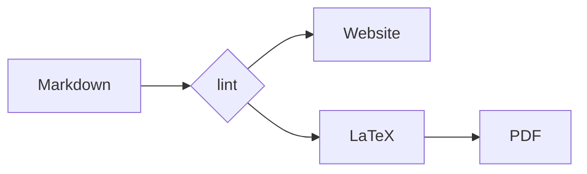

# A mermaid fence

*Sunt in culpa qui officia deserunt mollit anim id est laborum.*

A diagram is written like any other fenced block:

The build runs Mermaid in a small DOM, rewrites the labels it emits into plain
SVG text, and embeds the result in both editions. The website gets an inline
`<svg>`; the PDF gets a figure rendered from the same SVG.

Back to [diagrams](00_index.md).
