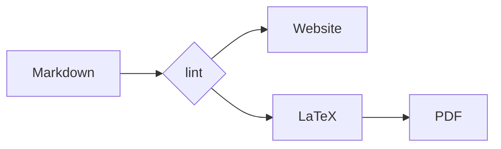

# Diagrams

*`mermaid` fences, drawn once and placed in both editions.*

A diagram is written like any other fenced block — the language is `mermaid`, and
the contents are Mermaid's own syntax:

The build runs Mermaid in a small DOM, rewrites the labels it emits into plain
SVG text, and embeds the result in both editions. The website gets an inline
`<svg>` that scales with the column; the printed edition gets a figure rendered
from the same drawing and placed to fit the text block. One source, two
renderings, no second version to keep in step.

A fence that Mermaid cannot parse fails the build when it is drawn, so a broken
diagram is caught by building the book rather than discovered on the printed
page.
