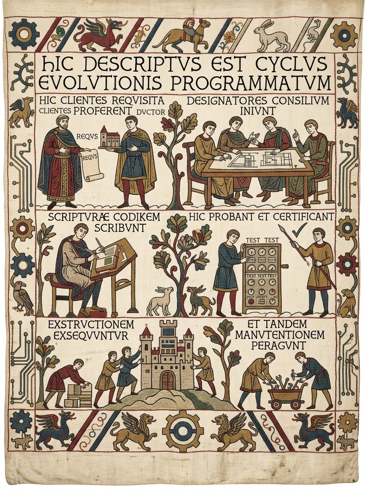

# A photograph

*Excepteur sint occaecat cupidatat non proident, sunt in culpa qui officia.*

The second spelling: a source counted from the file that carries it.

The opener wrote `/images/developer.jpg`, counting from the book root; this file
writes `../../images/sdlc.jpeg`, counting from its own directory. Both end up in
`book/images/`, and both editions find them — the site copies the file in beside
the page, the print build scales it to fit inside the text block. A source that
climbs out of the book directory is an error, not a surprise 404 in the built
book.

Repeating a picture is cheap: the engine copies each distinct source once per
chapter and reuses the copy, so a diagram referenced twice is stored once.

Back to [Images](00_index.md), or on to [Code](../03_code/00_index.md).
